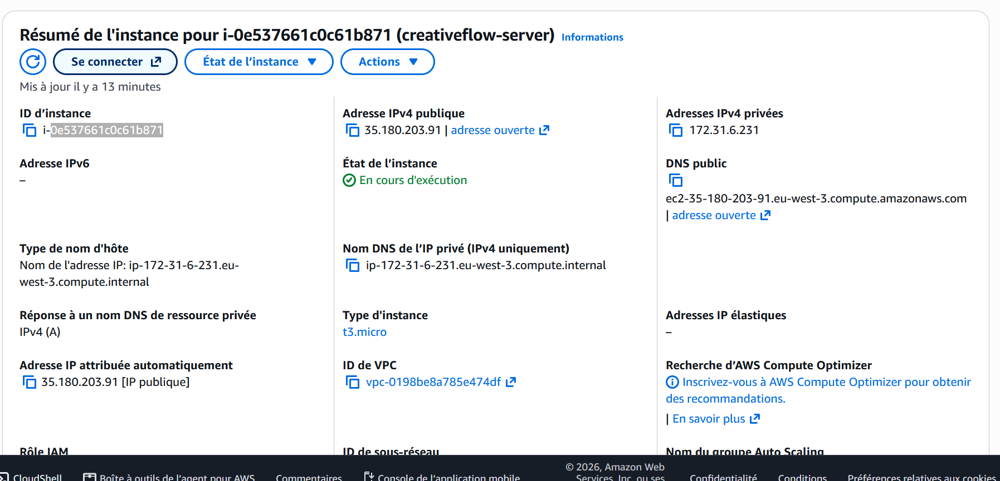
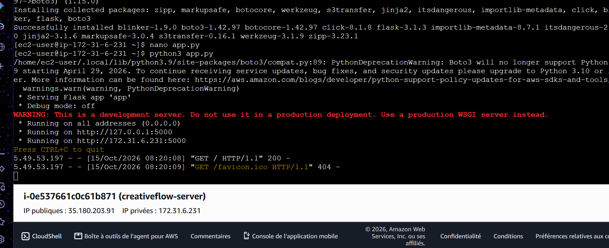

# CreativeFlow 

> Projet académique de gestion de documents cloud sécurisée et minimaliste, développé avec **AWS** (IAM, S3, EC2) et **Flask (Python)**.

---

##  Présentation du Projet
**CreativeFlow** est une application web conçue pour structurer, cloisonner et gérer des flux de documents créatifs de manière sécurisée dans le cloud, en respectant scrupuleusement les bonnes pratiques d'architecture et de sécurité (principe du moindre privilège).

---

##  Architecture et Composants Techniques

### 1. Sécurité et Gestion des Accès (IAM)
Pour éviter tout accès non autorisé, des politiques de sécurité granulaires ont été créées et rattachées à des rôles spécifiques :
* **`DeveloperS3Policy` / `EC2-Developer-Role`** : Rôle administrateur/développeur permettant la gestion complète du compartiment S3 et le déploiement du serveur.
* **`ContributorS3Policy` / `EC2-Contributor-Role`** : Rôle restreint destiné à limiter les contributeurs aux dossiers d'intégration et aux journaux (`app-logs/`).

### 2. Stockage et Organisation des Données (Amazon S3)
* **Compartiment (Bucket)** : `creativeflow-docs-davy`
* **Arborescence interne** :
  * `uploads/drafts/` (Brouillons)
  * `uploads/final/` (Fichiers validés)
  * `uploads/client-assets/` (Ressources clients)
  * `app-logs/` (Journaux applicatifs)
* **Politique de compartiment (Bucket Policy)** : Application d'une politique JSON stricte interdisant l'accès public et restreignant les écritures aux rôles habilités.

### 3. Calcul et Réseau (Amazon EC2 & Security Groups)
* **Instance** : Type `t3.micro` (sous Amazon Linux 2023), optimisé pour l'éligibilité et la gestion des crédits cloud.
* **Sécurité Réseau (Groupe de sécurité)** :
  * **Port 22 (SSH)** : Autorisé pour l'administration et la connexion sécurisée à distance (via la paire de clés `creativeflow-key`).
  * **Port 5000 (TCP Personnalisé)** :  **Point clé du réseau** — Ouverture du trafic entrant sur le port `5000` (`0.0.0.0/0`) indispensable pour permettre aux utilisateurs d'accéder publiquement à l'application web Flask hébergée sur le serveur.

---

##  Code Source de l'Application (`app.py`)

L'application utilise le SDK Python **Boto3** pour interroger dynamiquement le compartiment S3 en héritant automatiquement des permissions du rôle IAM attaché à l'instance EC2 :

```python
import os
import boto3
from flask import Flask

app = Flask(__name__)

BUCKET_NAME = "creativeflow-docs-davy"
s3_client = boto3.client("s3")


@app.route("/")
def home():
  try:
    response = s3_client.list_objects_v2(Bucket=BUCKET_NAME)
    contents = response.get("Contents", [])
    files = [item["Key"] for item in contents]

    html = f"""
        <h1>Bienvenue sur CreativeFlow 🚀</h1>
        <p>Connexion réussie au compartiment S3 : <b>{BUCKET_NAME}</b></p>
        <h3>Fichiers et dossiers actuels dans S3 :</h3>
        <ul>
        """
    for file in files:
      html += f"<li>{file}</li>"
    html += "</ul>"
    return html
  except Exception as e:
    return f"<h1>Erreur de connexion S3</h1><p>{str(e)}</p>"


if __name__ == "__main__":
  app.run(host="0.0.0.0", port=5000)

##  Captures d'Écran du Projet

* **Résumé de l'instance EC2 (`t3.micro`) :**  
  

* **Terminal du serveur Flask en cours d'exécution :**  
  

* **Rendu de la page Web `CreativeFlow` connectée à S3 :**  
  
